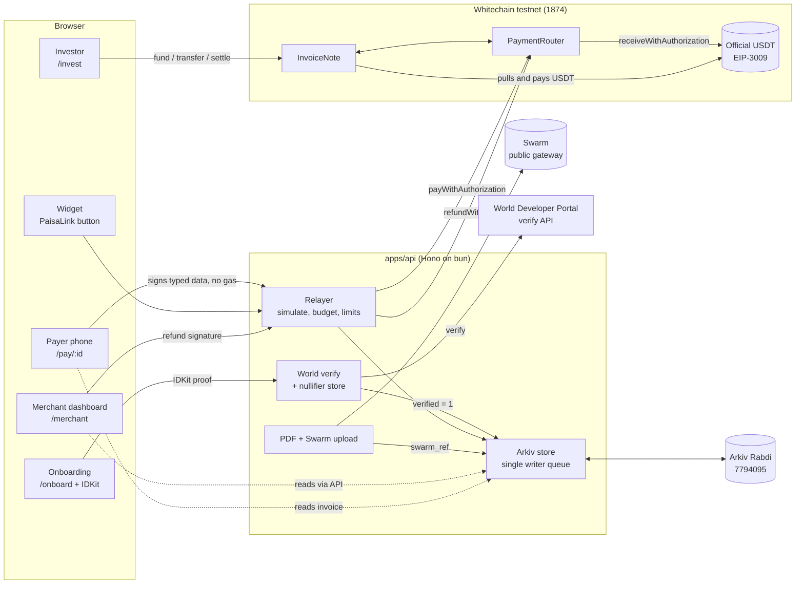

# PaisaLink

**Get paid in USDT on Whitechain with a link or a 20-line widget. Your client never needs gas, a seed phrase or a chain name.**

Built solo by [@aarjn](https://github.com/aarjn) for ETHGlobal Mumbai 2026 (Classic track). Sponsors: Whitechain, Arkiv, World. Everything runs on testnets. No real money is involved.

- Demo video (3 min): `TODO(owner): video URL` (after the owner uploads it)
- Live app: <https://paisalink.tailcdec7a.ts.net> (API health: <https://paisalink.tailcdec7a.ts.net/api/health>). Try it: open <https://paisalink.tailcdec7a.ts.net/merchant> to create an invoice, then open the pay link on a phone. `/demo-store` shows the widget, `/invest` the notes, `/onboard` World ID. This is Whitechain testnet only. The demo faucet's test USDT is nearly used up, so a judge may not be able to complete a payment; the demo video shows the full live flow.
- Submission text: [`docs/submission.md`](docs/submission.md)
- Demo narration and shot list: [`docs/demo-script.md`](docs/demo-script.md)

## Contents

1. [The problem](#the-problem)
2. [What PaisaLink does](#what-paisalink-does)
3. [Screenshots](#screenshots)
4. [Architecture](#architecture)
5. [How each sponsor is used](#how-each-sponsor-is-used)
6. [What breaks without each sponsor](#what-breaks-without-each-sponsor)
7. [Why onchain settlement on Whitechain](#why-onchain-settlement-on-whitechain)
8. [Gas and drain protection](#gas-and-drain-protection)
9. [Live vs demo shortcuts](#live-vs-demo-shortcuts)
10. [Setup from a clean machine](#setup-from-a-clean-machine)
11. [Contracts and transaction table](#contracts-and-transaction-table)
12. [Arkiv: writer wallet and a runnable query](#arkiv-writer-wallet-and-a-runnable-query)
13. [Tests](#tests)
14. [Current limitations](#current-limitations)
15. [AI usage](#ai-usage)
16. [Video chapters](#video-chapters)
17. [Licence](#licence)

## The problem

An Indian freelancer or exporter who bills a client abroad loses roughly **3 to 6 percent** of each invoice to bank and card fees and the currency spread. Then they wait days for the money. (This is the builder's working figure, not a measured one. `TODO(owner): add a source or soften the number before submitting.`)

Paying in a stablecoin fixes the cost and the wait. It creates new problems. The client must hold gas tokens, pick a network and sign a transaction they don't understand. The freelancer has no refund button, no invoice list, and nothing to give their accountant.

## What PaisaLink does

1. **Invoice.** A merchant creates an invoice (amount, due date, note). It becomes an Arkiv entity and a payment link, `/pay/<invoiceId>`.
2. **Gasless pay.** The client opens the link on a phone and taps Pay. They sign a typed message for the official Whitechain testnet USDT (EIP-3009 `receiveWithAuthorization`). Our relayer sends the transaction and pays the gas. The client never holds WBT.
3. **Live dashboard.** The merchant dashboard reads Arkiv and updates by itself. It shows the payment, the explorer link, a one-click refund, a CSV export for the accountant and a PDF receipt on Swarm.
4. **Sell the invoice.** An exporter with a 30-day invoice tokenises it as an `InvoiceNote`. An allowlisted investor funds it at a discount in USDT. At maturity the note settles in USDT. Transfers after maturity revert. The rules are in the contract, not the UI.
5. **Who gets gas.** A merchant must pass one World ID Proof of Human check to use the gas-sponsored path. If the check is cancelled or fails, the gasless path stays locked. The client can still pay with their own wallet through `pay()` and cover the gas themselves.
6. **Drop-in widget.** A separate shop adds the `<PaisaLink/>` button in about 20 lines ([`StoreCheckout.tsx`](apps/web/src/routes/demo-store/StoreCheckout.tsx) is 19 lines).

## Screenshots

Captured by the live Playwright runs and saved in `apps/web/e2e/screenshots/`. Run 3 (the recording run, 7 Nov 2026) evidence is in [`docs/live-run.md`](docs/live-run.md); rows that have no saved image point to the explorer or Arkiv entity instead.

| # | Screen | File |
|---|---|---|
| 1 | Merchant dashboard with a paid invoice and live update | `apps/web/e2e/screenshots/desktop-live-4-dashboard-paid.png` |
| 2 | Payer's phone: `/pay/<id>`, "Paid" state, no chain name | `apps/web/e2e/screenshots/desktop-live-2-paid.png` |
| 3 | Explorer page of the gasless USDT payment tx | [run 3 pay tx](https://explorer.testnet.whitechain.io/tx/0x0f89c838aacf418f6b020e4b58e5dca368109d53bf716a5463b493af89a3bf75) |
| 4 | Refund dialog and refund tx | `apps/web/e2e/screenshots/desktop-live-5-refund.png` |
| 5 | CSV opened in a spreadsheet | shown in the demo video (chapter 5) |
| 6 | Public receipt `/r/<id>` with "Open PDF on Swarm" | `apps/web/e2e/screenshots/desktop-live-7-swarm.png` |
| 7 | The invoice entity on the Rabdi explorer | invoice A entity link in [`docs/live-run.md`](docs/live-run.md) (Arkiv entities) |
| 8 | `/invest`: note funded, then "transfer after maturity" revert | shown in the demo video (chapter 8); `MaturityPassed` revert shown in the UI |
| 9 | `/onboard`: World ID success badge, and the locked banner after cancel | `apps/web/e2e/screenshots/world-success.png`, `apps/web/e2e/screenshots/world-cancel.png` |
| 10 | `/demo-store` next to its 19-line source | `apps/web/e2e/screenshots/desktop-demo-store.png` |

## Architecture

**Hosting:** one container on the builder's own server (Dokku + Tailscale Funnel), serving the web app at `/` and the API at `/api`. See [`docs/hosting-paisalink.md`](docs/hosting-paisalink.md).



- **Money and rules** live on Whitechain: `PaymentRouter` and `InvoiceNote`.
- **Records and search** live on Arkiv. There is no other database.
- **Files** live on Swarm. Only the plain reference goes in the Arkiv entity.
- **Humans** are checked by World ID. Only a `verified` flag goes in the Arkiv entity. Nullifiers stay on the API server.
- More detail: [`docs/specs/contracts.md`](docs/specs/contracts.md), [`arkiv/schema.md`](arkiv/schema.md), [`PLAN.md`](PLAN.md).

## How each sponsor is used

### Whitechain (Operate, Scale, Tokenize)

| What | Where |
|---|---|
| Official USDT `receiveWithAuthorization` called by the router, `to = router` | [`contracts/src/PaymentRouter.sol:162`](contracts/src/PaymentRouter.sol) (`payWithAuthorization` starts at line 147) |
| The EIP-3009 nonce is forced to `keccak256(abi.encode(router, invoiceId))`, so a signature can't be redirected to another invoice | [`PaymentRouter.sol:160-161`](contracts/src/PaymentRouter.sol), `paymentNonce` at line 169 |
| Payer-paid fallback `pay()` | [`PaymentRouter.sol:136`](contracts/src/PaymentRouter.sol) |
| Refund, signed refund, withdraw | [`PaymentRouter.sol:202`](contracts/src/PaymentRouter.sol) `refund`, `:209` `refundWithSig`, `:235` `withdraw` |
| USDT EIP-712 domain pinned (name "Tether USD", version "1", chain 1874) | [`packages/shared/src/usdt.ts:10`](packages/shared/src/usdt.ts) |
| Payer signs typed data only, in the browser | [`apps/web/src/routes/pay/index.tsx:106`](apps/web/src/routes/pay/index.tsx) |
| Relayer: World gate, simulation, budget, rate limits | [`apps/api/src/relayer.ts:174`](apps/api/src/relayer.ts) (gate), `:186` (simulate), `:194` (budget) |
| Allowlist on `fund` and `transfer`, maturity lock, USDT settlement | [`contracts/src/InvoiceNote.sol:97`](contracts/src/InvoiceNote.sol) `setAllowed`, `:159` `fund`, `:174` `transfer` (maturity check `:178`), `:214` `settle` (`:217`) |
| Drop-in widget and a 19-line separate store | [`packages/widget/src/index.tsx:22`](packages/widget/src/index.tsx), [`apps/web/src/routes/demo-store/StoreCheckout.tsx`](apps/web/src/routes/demo-store/StoreCheckout.tsx) |
| Accountant CSV export | [`apps/api/src/app.ts:176`](apps/api/src/app.ts), [`apps/api/src/csv.ts`](apps/api/src/csv.ts) |
| Foundry proof that the rules revert | [`contracts/test/InvoiceNote.t.sol`](contracts/test/InvoiceNote.t.sol) (for example `test_revert_fund_notAllowlisted`, `test_revert_transfer_afterMaturity`, `test_revert_settle_beforeMaturity`), and 4 fork tests against the real USDT in [`contracts/test/Fork.t.sol`](contracts/test/Fork.t.sol) |
| Feedback file | [`WHITECHAIN_FEEDBACK.md`](WHITECHAIN_FEEDBACK.md) |

### Arkiv (Build on Arkiv from scratch, plus the Swarm bonus)

| What | Where |
|---|---|
| `createArkivStore`: the only data layer | [`packages/arkiv/src/store.ts:496`](packages/arkiv/src/store.ts), used by [`apps/api/src/index.ts:10`](apps/api/src/index.ts) |
| Four schemas (`paisalink.merchants`, `.invoices`, `.payments`, `.notes`) | [`packages/arkiv/src/schemas.ts`](packages/arkiv/src/schemas.ts) |
| Expiry rules that follow product logic | [`packages/arkiv/src/mapping.ts:49`](packages/arkiv/src/mapping.ts) `invoiceLifetime` and neighbours |
| Reads filtered by owner (`ownedBy(writer)`), so forged entities are ignored | [`store.ts:119`](packages/arkiv/src/store.ts), `:148`, `:170`, `:235` |
| Atomic batch: payment record + invoice `paid` in one transaction | [`store.ts:215`](packages/arkiv/src/store.ts) |
| Lease renewal with `extendEntity` | [`store.ts:387`](packages/arkiv/src/store.ts) |
| Live updates with `watchEntityEvents` over WebSocket | [`store.ts:293`](packages/arkiv/src/store.ts) |
| Features users see that read Arkiv: dashboard list, checkout page, public receipt | [`apps/api/src/routes/merchants.ts:82`](apps/api/src/routes/merchants.ts), [`apps/api/src/app.ts:124`](apps/api/src/app.ts) (`GET /invoices/:id`), [`apps/web/src/routes/receipt/index.tsx`](apps/web/src/routes/receipt/index.tsx) |
| Swarm PDF upload, plain reference only | [`apps/api/src/swarm.ts:65`](apps/api/src/swarm.ts) `assertPlainReference`, `:97` upload; [`apps/api/src/pdf.ts:117`](apps/api/src/pdf.ts) render, `:225` routes |
| `swarm_ref` on the invoice entity | [`packages/arkiv/src/schemas.ts:23`](packages/arkiv/src/schemas.ts) |
| Criterion files | [`arkiv/`](arkiv/) |

### World (Best Use of IDKit)

| What | Where |
|---|---|
| IDKit 4.6.0 widget, Proof of Human, signal = merchant wallet | [`apps/web/src/routes/onboard/index.tsx:100`](apps/web/src/routes/onboard/index.tsx) (request), `:174` (widget) |
| Server-signed request (`signRequest`) | [`apps/api/src/world.ts:321`](apps/api/src/world.ts) |
| Server-side verification and `worldRoutes` | [`apps/api/src/world.ts:346`](apps/api/src/world.ts) |
| Signal binding check (`hashSignal`) | [`apps/api/src/world.ts:230`](apps/api/src/world.ts) |
| Nullifier store (reuse returns `409 NULLIFIER_REUSED`) | [`apps/api/src/world.ts`](apps/api/src/world.ts), file `.data/nullifiers.json` (git-ignored) |
| The unlock: relayer refuses unverified merchants | [`apps/api/src/relayer.ts:174`](apps/api/src/relayer.ts) |
| Credential reasoning and debrief | [`docs/WORLD_DEBRIEF.md`](docs/WORLD_DEBRIEF.md) |

## What breaks without each sponsor

- **Without Whitechain:** no official-USDT settlement, no EIP-3009 gasless pay, and no allowlist and maturity rules for the invoice note. There is nothing to refund and nothing to sell.
- **Without Arkiv:** no invoices, receipts, merchant profiles or notes to show. The dashboard, pay page and receipt page are all empty, because there is no other database.
- **Without Swarm:** the invoice still works, but there is no permanent, tamper-evident PDF receipt to forward to a client or an accountant.
- **Without World:** anyone can open unlimited merchant accounts and drain the relayer's gas. The only safe fallback is to turn gasless payment off.

## Why onchain settlement on Whitechain

- A client abroad pays in a dollar stablecoin and the freelancer sees it settle in seconds, with no bank cut and no cut-off hours.
- A refund is a rule in the router. It can only go back to the recorded payer, and only from the invoice balance. No card network is needed and no chargeback can happen.
- An invoice sale needs an enforced allowlist, a maturity lock and settlement in the same stablecoin. A normal payment rail can't enforce those rules between strangers. A contract can.
- The payer signs a message. They never need the network's gas token. That is only possible because the USDT supports EIP-3009.

## Gas and drain protection

How the business pays gas, how the relayer gets WBT, and what stops draining:

- **Who pays:** the relayer wallet pays the WBT gas for each customer payment (about 0.0001 WBT). In a real deployment the business tops up the relayer. In this demo, testnet faucets do.
- **World ID gate:** only merchants who passed Proof of Human are relayed (`MERCHANT_NOT_VERIFIED` otherwise). One human gets one budget.
- **Per-merchant budget:** 0.02 WBT per merchant per UTC day (`BUDGET_EXCEEDED`).
- **Rate limits:** 10 relays per payer address per hour, 60 per IP per hour, 300 per hour in total (`RATE_LIMITED`).
- **Simulation first:** every relay is run with `eth_call` before it is sent. A reverting call never spends gas.
- **Tight authorization:** `to` must be our router, `value` must equal the invoice amount, `validBefore` must be within 10 minutes, the nonce is bound to the invoice, and the invoice must be open.
- **Health:** `GET /health` shows the relayer balance and the queue depth.

## Live vs demo shortcuts

Everything below is a testnet shortcut. Each one is labelled in the UI.

| Shortcut | What it is | What production would do |
|---|---|---|
| **Browser-local demo wallets** | `merchant`, `payer` and `investor` keys are generated and stored in this browser's `localStorage` (`apps/web/src/lib/wallet.ts:9`). The UI shows a "testnet demo wallet" tag. They hold only testnet funds. | Real wallets, or embedded or smart-account wallets. |
| **`POST /demo/fund`: testnet faucet** | Sends test USDT from our deployer wallet to a demo wallet so a judge can try checkout (`apps/api/src/app.ts:212`, `apps/api/src/demo.ts`). It works on chain 1874 only. | No faucet. Clients bring their own USDT. |
| **`POST /notes/demo-investor`: "demo compliance desk"** | The contract owner (the "compliance officer") allowlists the browser demo investor and sends it a little WBT for gas (`apps/api/src/routes/notes.ts:490`). On chain 1874 only, rate-limited, labelled in the UI. | A compliance officer allowlists an investor after KYC. Nobody is allowlisted automatically. |
| **Swarm public gateway** | PDFs go up through the Swarm Foundation public gateway, which uses its own postage batch. We do not own a batch and can't see its ID or lifetime ([`arkiv/swarm.md`](arkiv/swarm.md)). | Our own Bee node and our own postage batch. |
| **World ID staging** | The World app uses the staging environment and the simulator, not the real World App with a real Orb credential. | Production environment and real Proof of Human. |
| **Short maturity** | Demo notes mature after about 120 seconds so the whole lifecycle fits in a video. | Real due dates, for example 30 days. |
| **Test USDT** | The official Whitechain testnet USDT, from the faucet and the testnet swap. It is not a token we minted. It has no value. | Mainnet USDT. |
| **Single Arkiv writer** | One server wallet writes all entities (`ownedBy(writer)` filters reads). | Merchant-owned entities with per-wallet writers, or an access-controlled writer set. |

Nothing in the running app is mocked. Chain calls, Arkiv writes, Swarm uploads and World verification are all real calls to testnets. Fakes exist only inside test files.

## Setup from a clean machine

You need [bun](https://bun.sh) 1.4.3 and [Foundry](https://book.getfoundry.sh/) 1.9. You do not need node or npm.

```bash
# 1. Install the tools
curl -fsSL https://bun.sh/install | bash          # bun
curl -L https://foundry.paradigm.xyz | bash       # then restart the shell and run: foundryup
export PATH="$HOME/.foundry/bin:$PATH"

# 2. Get the code and install packages (from the repo root)
git clone https://github.com/aarjn/eth-global-nov-26.git
cd eth-global-nov-26
bun install

# 3. Contracts
cd contracts && forge build && forge test && cd ..

# 4. Environment: copy the template and fill in your own values
cp .env.example .env.local
```

`.env.local` is git-ignored. Fill in these names (values are never in the repo):

| Needed for | Variables |
|---|---|
| Chain | `WC_RPC_URL=https://rpc.testnet.whitechain.io`, `WC_CHAIN_ID=1874`, `WC_EXPLORER_URL=https://explorer.testnet.whitechain.io`, `USDT_ADDRESS=0xcedfB56113143d55b2358b8CFbB0dEB5Ad2f55a7` |
| Deploy and relay | `DEPLOYER_PRIVATE_KEY`, `RELAYER_PRIVATE_KEY` (use fresh testnet keys, fund them with WBT from the [Whitechain faucet](https://faucet.testnet.whitechain.io)) |
| Arkiv writes | `ARKIV_PRIVATE_KEY`, `ARKIV_ACCESS_KEY` (from [hub.arkiv.network](https://hub.arkiv.network)), `ARKIV_RPC_URL` |
| World ID | `WORLD_APP_ID`, `WORLD_RP_ID`, `WORLD_SIGNING_KEY`, `WORLD_ACTION=paisalink-merchant` (a staging app from the Developer Portal) |
| Demo wallets (optional) | `DEMO_MERCHANT_PRIVATE_KEY`, `DEMO_PAYER_PRIVATE_KEY`, `DEMO_INVESTOR_PRIVATE_KEY` |
| Swarm (optional) | leave `BEE_URL` empty to use the public gateway, or set `BEE_URL` and `BEE_BATCH_ID` |
| Public links (optional) | `PUBLIC_APP_URL` (printed in the PDF), `VITE_API_URL` |

The repo author keeps secrets in a private tool (`bash scripts/load-env.sh` writes `.env.local` from it). You don't have that tool. Copy `.env.example` instead.

```bash
# 5. Deploy the contracts (needs about 0.03 WBT on the deployer)
cd contracts
set -a && . ../.env.local && set +a
forge script script/Deploy.s.sol --rpc-url whitechain_testnet --broadcast
bun script/write-deployment.ts      # writes contracts/deployments/1874.json
bash script/verify.sh               # verifies both contracts on the Whitechain explorer
cd ..
# Or skip the deploy and set PAYMENT_ROUTER_ADDRESS and INVOICE_NOTE_ADDRESS to the addresses below.

# 6. Run the API (port 8787) and the web app (port 5173), in two terminals
bun run dev:api
bun run dev:web
```

Then open `http://localhost:5173/merchant` (local Setup only; the public app is at the link above). Useful extras:

```bash
bun --env-file=.env.local scripts/fund-demo.ts --balances        # WBT and USDT of all demo wallets
bun --env-file=.env.local scripts/fund-demo.ts payer 60          # move test USDT to the demo payer
curl http://localhost:8787/health                                  # chain ids, relayer balance, Arkiv status
```

Routes: `/merchant` (dashboard), `/pay/:id` (payer), `/r/:id` (public receipt), `/invest` (investor), `/onboard` (World ID), `/demo-store` (the widget in a separate shop).

## Contracts and transaction table

Everything is on Whitechain Sepolia testnet (chain id 1874). Explorer: <https://explorer.testnet.whitechain.io>.

The payments use the **official test USDT** `0xcedfB56113143d55b2358b8CFbB0dEB5Ad2f55a7` ([explorer](https://explorer.testnet.whitechain.io/address/0xcedfB56113143d55b2358b8CFbB0dEB5Ad2f55a7)). We did not mint our own token.

### Contracts (verified)

| Contract | Address | Verified source |
|---|---|---|
| PaymentRouter | `0x97613d5bE2c3dd747c110b460Ff2e0FC69701005` | [verified code](https://explorer.testnet.whitechain.io/address/0x97613d5bE2c3dd747c110b460Ff2e0FC69701005?tab=contract) |
| InvoiceNote | `0x9e9Fa5E8857a309C51d18822182e9BDcd0117Ac7` | [verified code](https://explorer.testnet.whitechain.io/address/0x9e9Fa5E8857a309C51d18822182e9BDcd0117Ac7?tab=contract) |

Deployer / owner: `0xf4a0841215766eAD8239d223E4E8caB91ff1fDeb`. Relayer / operator: `0x645bDbd12f7EC7cf773b0C13Dce941057057DA8F`. Machine-readable record: [`contracts/deployments/1874.json`](contracts/deployments/1874.json) (`deployed` is `true`; deploy block 12343606).

### Transactions

| Step | Tx hash | Explorer link |
|---|---|---|
| Deploy PaymentRouter | `0xe9182174222dd560741c8b6d5866ea13a5186a024c15b7d1b3020172243bfdcf` | [tx](https://explorer.testnet.whitechain.io/tx/0xe9182174222dd560741c8b6d5866ea13a5186a024c15b7d1b3020172243bfdcf) |
| Deploy InvoiceNote | `0x74a875fc9ea553a46c53439553bfca2c36b8cd660cda2ac10331fc688ceaccaf` | [tx](https://explorer.testnet.whitechain.io/tx/0x74a875fc9ea553a46c53439553bfca2c36b8cd660cda2ac10331fc688ceaccaf) |
| **Run 3 (full lifecycle, recording run)** | | |
| Invoice A create, 1.00 USDT | `0xcd2f292049c0d1413d33cbc650eda19480fcce9db1d0bc8eb38132a749413721` | [tx](https://explorer.testnet.whitechain.io/tx/0xcd2f292049c0d1413d33cbc650eda19480fcce9db1d0bc8eb38132a749413721) |
| Gasless USDT payment (`payWithAuthorization`, payer paid no gas), 1.00 USDT | `0x0f89c838aacf418f6b020e4b58e5dca368109d53bf716a5463b493af89a3bf75` | [tx](https://explorer.testnet.whitechain.io/tx/0x0f89c838aacf418f6b020e4b58e5dca368109d53bf716a5463b493af89a3bf75) |
| Partial refund, 0.20 USDT | `0x97f679d331148c9b9c90975eb161e774e97fb1f02c2f2d0eb905d15a44a0eb8f` | [tx](https://explorer.testnet.whitechain.io/tx/0x97f679d331148c9b9c90975eb161e774e97fb1f02c2f2d0eb905d15a44a0eb8f) |
| Invoice B create, 0.50 USDT | `0x886b77138697a53dcd6433369a625b19d216f6380a1e3d93b6cb15e9cc13fe74` | [tx](https://explorer.testnet.whitechain.io/tx/0x886b77138697a53dcd6433369a625b19d216f6380a1e3d93b6cb15e9cc13fe74) |
| Note issued (`issueWithSig`), note #2, face 0.50, price 0.45 | `0x036643ed5c9d83bbb053f60100adbf7756681580e31326e91e6cdcf10b567961` | [tx](https://explorer.testnet.whitechain.io/tx/0x036643ed5c9d83bbb053f60100adbf7756681580e31326e91e6cdcf10b567961) |
| Investor allowlisted | `0x2c0fd232c95bbe9cee83877318be3d3d1f8f10e6da9f9575ba7553531f15ebb6` | [tx](https://explorer.testnet.whitechain.io/tx/0x2c0fd232c95bbe9cee83877318be3d3d1f8f10e6da9f9575ba7553531f15ebb6) |
| Note funded by the investor (`fund`), 0.45 USDT to the merchant | `0xaa8ffc9cc5ca53cd368b149ea0d75ede6e8fcfb0e76a01a1965b39e5f7f52636` | [tx](https://explorer.testnet.whitechain.io/tx/0xaa8ffc9cc5ca53cd368b149ea0d75ede6e8fcfb0e76a01a1965b39e5f7f52636) |
| Payment forwarded to note escrow (gasless pay of invoice B, 0.50 USDT) | `0xfff0ea707fe1e2dbda5aaaf4afb3b1b000f4d0db3cdb70fdd5a29abb6102daf8` | [tx](https://explorer.testnet.whitechain.io/tx/0xfff0ea707fe1e2dbda5aaaf4afb3b1b000f4d0db3cdb70fdd5a29abb6102daf8) |
| Transfer after maturity (reverts with `MaturityPassed`; shown as a failed simulation in the UI) | none (the call reverts before it is sent) | `MaturityPassed` revert shown in the UI (no tx, no screenshot file) |
| Note settled in USDT (`settle`), holder receives 0.50 USDT | `0x5f203b7f7be1e072ba58f189ea2165d07de1944e1fc26e81e3be4fa83d3251a0` | [tx](https://explorer.testnet.whitechain.io/tx/0x5f203b7f7be1e072ba58f189ea2165d07de1944e1fc26e81e3be4fa83d3251a0) |
| **Extra evidence: earlier runs** | | |
| Gasless USDT payment, 1.00 USDT, the first one | `0x07c94ba03059287729b65b5eb35f76bd6787687d672ec4bc1b881abe1e5ac36e` | [tx](https://explorer.testnet.whitechain.io/tx/0x07c94ba03059287729b65b5eb35f76bd6787687d672ec4bc1b881abe1e5ac36e) |
| Gasless USDT payment, 4.90 USDT (live run 2) | `0x9957efd2d6d04ac8301c00990182dc0502c2899f0b58171b2c9cfa011f5c0c33` | [tx](https://explorer.testnet.whitechain.io/tx/0x9957efd2d6d04ac8301c00990182dc0502c2899f0b58171b2c9cfa011f5c0c33) |
| Partial refund (`refundWithSig`), 0.90 USDT (live run 2) | `0x0405f8d08472299c173a757d0ab59eb6d06b93ecb1b1491e71d8f9d2fb3c5335` | [tx](https://explorer.testnet.whitechain.io/tx/0x0405f8d08472299c173a757d0ab59eb6d06b93ecb1b1491e71d8f9d2fb3c5335) |
| Note issued, note #1, face 1.00, price 0.95 (live run 2) | `0x1aa3d9187194912ed5c8d9f12b306ddc3993b4398fcd1deb5ede02537e690dea` | [tx](https://explorer.testnet.whitechain.io/tx/0x1aa3d9187194912ed5c8d9f12b306ddc3993b4398fcd1deb5ede02537e690dea) |

All run 3 hashes were checked with `cast receipt` (status 1). Full list, with the Arkiv entities and Swarm PDF: [`docs/live-run.md`](docs/live-run.md).

## Arkiv: writer wallet and a runnable query

- **Writer wallet** (the only wallet that writes entities): `0xf4a0841215766eAD8239d223E4E8caB91ff1fDeb`. [Rabdi explorer page](https://rabdi.explorer.arkiv.network/address/0xf4a0841215766eAD8239d223E4E8caB91ff1fDeb).
- **Network:** Arkiv Rabdi testnet, chain id 7794095, RPC `https://rpc.rabdi.db-chain.testnet.arkiv.network`.
- **Entity example:** the paid invoice A, with its `swarm_ref`, is linked in [`docs/submission.md`](docs/submission.md) (section Arkiv) and listed with the other entities in [`docs/live-run.md`](docs/live-run.md). The README does not repeat the 64-character key, because `scripts/verify-submission.ts` reads every such key in the README as a transaction hash.

Run the query yourself. It reads the entities straight from Arkiv. It needs no API server, no database and no keys:

```bash
bun install
bun run scripts/query.ts                       # the demo merchant
bun run scripts/query.ts 0xYourMerchantAddr    # any merchant address
```

It prints the exact query it sends. For the demo merchant that is the equivalent of:

```
arkiv.schema = "paisalink.invoices" AND merchant = 0xC038827b4E362B0de1Be859377508613CD028946 AND $owner = 0xf4a0841215766eAD8239d223E4E8caB91ff1fDeb
```

Output before any invoice exists: "no merchant entity yet" and "no invoices". After the demo it lists each invoice with its state, amount, pay tx and whether it has a `swarm_ref`. Real output:

```
merchant @priya.designs  0xC038827b4E362B0de1Be859377508613CD028946  World ID verified: yes
 invoice      state  usdt  due         memo                    paid_tx       swarm
 0x1ce3e36f…  open   1     2026-11-13  e2e invoice B mw4jzhbd
 0x8e9ab8f5…  paid   4.9   2026-11-13  e2e invoice A mw4jzhbd  0x9957efd2d6  yes
 0x62f167a2…  open   4.9   2026-11-13  e2e invoice A mw4jlyby
 0x92314a9d…  open   1     2026-11-07  W8 dry check (unpaid)
4 invoice(s), 1 payment(s)
```
(Output of `bun run scripts/query.ts` on 7 Nov 2026 after live run 2. The table is condensed from the script's box drawing.)

Judge files: [`arkiv/schema.md`](arkiv/schema.md), [`arkiv/friction.md`](arkiv/friction.md), [`arkiv/reach.md`](arkiv/reach.md), [`arkiv/why-arkiv.md`](arkiv/why-arkiv.md), [`arkiv/how-you-use-arkiv.md`](arkiv/how-you-use-arkiv.md), [`arkiv/swarm.md`](arkiv/swarm.md).

## Tests

Run on 7 Nov 2026. The command list is the one in [`docs/handoffs.md`](docs/handoffs.md) ("S1 findings").

```bash
export PATH=$HOME/.foundry/bin:$PATH
(cd contracts && forge test)                                         # 79 passed, 1 skipped
(cd contracts && RUN_FORK=1 forge test --match-contract ForkUSDT)    # 5 passed (real USDT on a fork of chain 1874)
bun test apps/api                                                    # 127 pass, 1 skip (live Swarm test), 0 fail
bun test packages                                                    # 47 pass, 6 skip (live Arkiv tests: arkiv 37 + shared 10; widget has no tests), 0 fail
(cd apps/web && bun test && bun run typecheck && bun run build)     # 26 pass, typecheck and build green
```

| Suite | Result |
|---|---|
| Foundry unit and fuzz tests (`contracts/test`) | 79 passed, 1 skipped |
| Foundry fork tests against the real USDT | 5 passed |
| API tests (`apps/api/test`, includes anvil integration tests of the real compiled contracts) | 127 pass, 1 skip |
| Package tests (`packages/arkiv`, `packages/shared`) | 47 pass, 6 skip |
| Web tests (`apps/web`, includes `/invest` and `/onboard`) | 26 pass |
| **Total** | **284 pass, 8 skip, 0 fail** |

Skipped tests need live services: a live Swarm upload (`SWARM_LIVE=1`) and live Arkiv writes (they need a funded writer and an access key). Counts will change as tests are added.

## Current limitations

- Testnet only. Test USDT has no value, and World ID runs in staging.
- One server wallet writes all Arkiv entities.
- The relayer and the compliance desk are single wallets with testnet funds.
- Swarm uploads use a public gateway whose postage batch and retention we can't see.
- Browser-local demo wallets are not secure storage.
- Contracts are unaudited. The router has Foundry tests, fuzz tests and fork tests, not a review.
- Financing: the note price is a fixed demo discount, with no credit check or pricing model.
- INR amounts shown in the UI are indicative only.

## AI usage

The code was written by Claude agents. Opus wrote the code. Sonnet wrote tests and docs. Fable did the research and the plan. The human builder chose the product, the sponsors and the trade-offs, tested on a phone, and directed and reviewed the work. The prompts and specs are saved in [`docs/prompts/`](docs/prompts/) and [`docs/specs/`](docs/specs/). The per-file list is in [`AI_USAGE.md`](AI_USAGE.md).

## Video chapters

`PENDING(cut)`: timestamps are filled in after the final cut.

| Time | Chapter |
|---|---|
| `PENDING(cut)` | Problem |
| `PENDING(cut)` | Invoice created (Arkiv entity) |
| `PENDING(cut)` | Gasless pay on a phone |
| `PENDING(cut)` | Live dashboard, refund |
| `PENDING(cut)` | CSV and Swarm PDF |
| `PENDING(cut)` | Sell the invoice, rule refusal, settle |
| `PENDING(cut)` | World ID denied, then verified |
| `PENDING(cut)` | What breaks without each sponsor |

## Licence

MIT. See [`LICENSE`](LICENSE). Copyright (c) 2026 aarjn.
